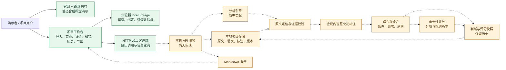

# 智慧火花碰撞 · 整体架构与交付状态

状态：**项目架构图，包含现状与目标**。核对时间：2026-10-17，上海时间约 14:00。依据为远端 `work/interaction-ux@d61a5de`、`work/demo-site-deck@eef34a5`、`work/engine-service@2bd20ba` 和用户确认“服务尚未开始写”。实线表示当前已有代码或材料；虚线表示接口、引擎或数据链路仍待实现与联调。图中的目标节点不是已交付功能。

## 数据主线

`项目 → 会议/访谈/聊天场次 → 原始记录 → 可定位片段 → 会议内标注 → 跨会议关联 → 智慧点 → 重要性/趋同/证据把握 → 判断与评分快照 → 可读导出`。

场次是频次的去重单位。一场会议内多份文件或多次提及只增加证据，不增加场次数；同一人跨场发言可增加场次覆盖，不增加独立人数。不同条件保留分支；高频争议仍是“重要但未趋同”。一次性关键约束可提示“需关注”。没有新依据时允许“无新火花”。原文、他人观点、AI 推断和明确批准的行动分开，产品不自动执行外部任务；项目记忆更新不是模型训练。

## 模块、当前证据与责任边界

| 模块 | 当前可核查状态 | 下一交付 | 建议责任 |
| --- | --- | --- | --- |
| 官网与路演 PPT | `demo/` 为独立静态合成演示，销售报价案例点击后切换预设状态；不调用分析服务 | 与工作台统一同一演示故事和“合成”说明 | 展示/产品与交互共同 |
| 项目工作台 | 一鸣分支有材料、首页、详情、纠错、历史、导出、火花路径交互；91 项 Node 测试通过，本地页面返回 HTTP 200 | 场次分组输入、跨场频次与评分展示、趋同单列、来源路径进入导出 | 一鸣负责交互与接口文档 |
| 浏览器草稿 | `localStorage` 保存草稿、服务绑定和重试状态；清理站点数据会丢失 | 对已提交材料和历史统一显示服务端状态，不让本地缓存冒充服务持久化 | 一鸣 |
| HTTP 契约 | v0.1 客户端、13 个建议路由及可选 `spark` 来源扩展已有代码/文档；合同仍待双方确认 | 补 `meeting_id`、会议内标注、按场去重计数、评分分项、趋同状态及快照语义 | 双方共同冻结；一鸣维护前端契约 |
| API、引擎与项目存储 | 用户确认服务尚未开始写；远端引擎分支只有接口评审文档 | 本地服务、原文存储、证据校验、分析任务、跨会议聚合、评分与版本、导出 | 用户按已提议分工负责引擎与服务 |
| 联调与验收 | 前端单元测试与合成数据/模拟服务检查已做；真实服务端到端尚无证据 | 用同一组 3–5 场合成/获准短材料走通 A1–A14；明确 mock/live | 双方共同 |

## 接口中尚未冻结的关键对象

当前 v0.1 契约以 **Record 与记录覆盖数** 为中心；新产品范围需要明确的 **Meeting 与会议覆盖数**。前端现有 `spark` 可选扩展描述“何时发生单场/跨场认知变化”，不等于“一个智慧点在多少场会议中被实质讨论”。这两条信号必须分别建模：

- `meeting_id` 与场次元数据由明确输入或可靠来源给出；不能从文件数、标题、同名者或日期猜测。
- 会议内标注关联 `span_id`、`spark_id`、关系、条件、发言者和主动/被问状态；跨会议关联保留各场来源与理由。
- 按智慧点和适用条件返回 `distinct_meeting_count / total_meeting_count`、去重发言者、支持/质疑/补充/反例；未讨论不算反对。
- 重要性评分返回规则版本、分项和原始计数；趋同、证据把握、批准状态各自独立；新增会议后保留旧评分快照。

字段名是待双方确认的建议；以现有 [产品定义](product-definition.md)、[MVP 验收](mvp-acceptance.md) 和一鸣分支的 `docs/api-contract.md` / `docs/spark-origins-contract.md` 对齐后再冻结。
